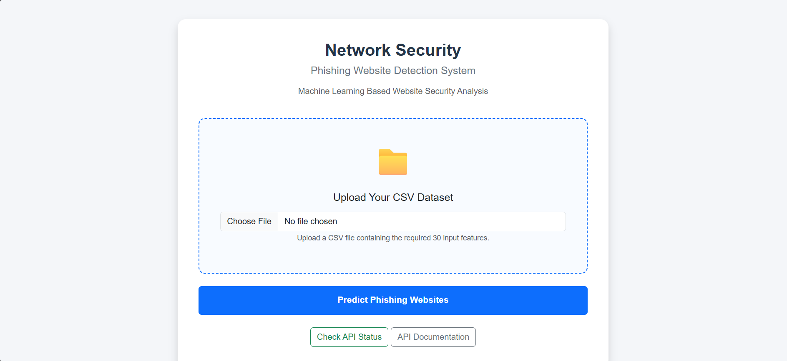
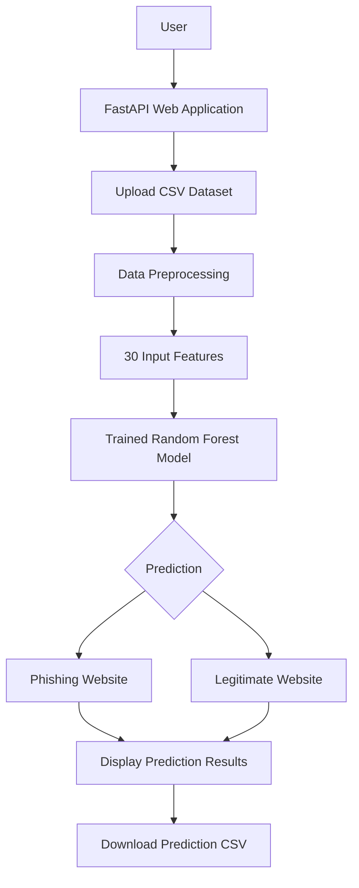
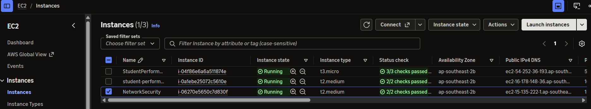
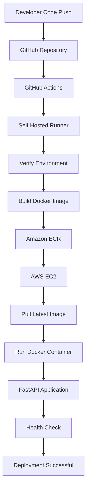

# 🛡️ Network Security – Phishing Website Detection using Machine Learning & AWS CI/CD

An end-to-end Machine Learning application that detects phishing websites using a **Random Forest Classifier**. The project integrates FastAPI, MongoDB Atlas, Docker, AWS EC2, Amazon ECR, and GitHub Actions to automate application deployment through a CI/CD pipeline.

<p align="center">
  
</p>

---

## 📌 Table of Contents

- [Project Overview](#-project-overview)
- [Key Features](#-key-features)
- [Dataset Information](#-dataset-information)
- [Technology Stack](#-technology-stack)
- [System Architecture](#-system-architecture)
- [Machine Learning Workflow](#-machine-learning-workflow)
- [Model Evaluation](#-model-evaluation)
- [Application Screenshots](#-application-screenshots)
- [API Endpoints](#-api-endpoints)
- [Evidence and Validation](#-evidence-and-validation)
- [CI/CD Pipeline](#-cicd-pipeline)
- [AWS Deployment](#-aws-deployment)
- [Run Locally](#-run-locally)
- [Docker Deployment](#-docker-deployment)
- [Project Structure](#-project-structure)
- [Challenges and Solutions](#-challenges-and-solutions)
- [Future Improvements](#-future-improvements)
- [Learning Outcomes](#-learning-outcomes)
- [Author](#-author)

---

## 📖 Project Overview

Phishing websites are malicious websites designed to imitate legitimate websites to steal sensitive information, including login credentials, personal information, and financial details.

This project uses Machine Learning to analyze website-related features and classify websites into two categories:

- **Phishing:** Website classified as potentially malicious.
- **Legitimate:** Website classified as legitimate by the trained model.

The trained Random Forest model is integrated into a FastAPI application. Users can upload CSV files containing website features and receive predictions through the web interface.

The application is containerized using Docker and deployed on AWS EC2. GitHub Actions automates the build and deployment process.

---

## 🚀 Key Features

- Phishing website detection using Machine Learning.
- Random Forest classification algorithm.
- Dataset containing 11,055 records and 30 input features.
- Automated data ingestion and preprocessing.
- Model training and prediction pipeline.
- FastAPI-based web application.
- CSV-based batch predictions.
- MongoDB Atlas integration.
- Docker containerization.
- AWS EC2 deployment.
- Amazon ECR for Docker image storage.
- GitHub Actions CI/CD automation.
- Application health-check endpoint.
- Swagger API documentation.

---

## 📊 Dataset Information

The model was trained using a phishing website dataset.

| Dataset Attribute | Value |
|---|---:|
| Total Records | 11,055 |
| Input Features | 30 |
| Target Variable | 1 |
| Total Columns | 31 |
| Target Column | `Result` |
| Algorithm | Random Forest Classifier |
| Problem Type | Binary Classification |

### Dataset Explanation

- **11,055 records:** Total number of website samples in the dataset.
- **30 input features:** Website attributes provided to the machine learning model.
- **1 target variable:** The output column used for classification.
- **31 total columns:** 30 input features plus one target column.

The model uses the 30 input features to predict whether a website is phishing or legitimate.

---

## 🛠️ Technology Stack

| Category | Technologies |
|---|---|
| Programming Language | Python |
| Machine Learning | Scikit-learn |
| ML Algorithm | Random Forest |
| Data Processing | Pandas, NumPy |
| Backend Framework | FastAPI |
| Database | MongoDB Atlas |
| Model Serialization | Pickle |
| API Server | Uvicorn |
| Containerization | Docker |
| Cloud Platform | AWS |
| Container Registry | Amazon ECR |
| Cloud Deployment | Amazon EC2 |
| CI/CD | GitHub Actions |
| Version Control | Git, GitHub |

---

## 🏗️ System Architecture

The following diagram represents the overall application workflow.



---

## 🧠 Machine Learning Workflow

The project follows an end-to-end Machine Learning pipeline.

1. Dataset collection.
2. Data ingestion.
3. Data validation.
4. Data transformation.
5. Feature preparation.
6. Random Forest model training.
7. Model evaluation.
8. Model serialization.
9. Prediction using the trained model.

### Model Information

**Algorithm:** Random Forest Classifier

Random Forest is an ensemble learning algorithm that combines multiple decision trees to perform classification.

The trained model analyzes 30 input features and generates a binary classification prediction.

---

## 📈 Model Evaluation

Model evaluation is important to understand how well the classifier performs on unseen data.

The following metrics should be populated using the actual test-set evaluation results.

| Evaluation Metric | Result |
|---|---|
| Accuracy | Add actual result |
| Precision | Add actual result |
| Recall | Add actual result |
| F1-Score | Add actual result |

### Confusion Matrix

Add your actual confusion matrix here after model evaluation.

```text
                 Predicted
                 Negative    Positive

Actual Negative     TN          FP

Actual Positive     FN          TP
```

### Evaluation Metrics Explanation

- **Accuracy:** Measures the proportion of correct predictions.
- **Precision:** Measures how many predicted phishing cases were actually phishing.
- **Recall:** Measures how many actual phishing cases were correctly detected.
- **F1-Score:** Harmonic mean of precision and recall.

> Evaluation values should be taken from the model's actual test results. Do not use training accuracy as a substitute for test performance.

---

## 🖥️ Application Screenshots

### 1. Application Home Page

The home page allows users to upload a CSV dataset containing the required input features.


### 2. Prediction Results

The application processes uploaded website records and generates predictions.


### 3. FastAPI Swagger Documentation

Swagger UI provides interactive API documentation for testing application endpoints.


### 4. GitHub Actions CI/CD Pipeline

GitHub Actions automates the Docker build and deployment workflow.


### 5. AWS EC2 Deployment

The application is deployed and hosted on an AWS EC2 instance.



---

## 🔌 API Endpoints

The FastAPI application provides the following endpoints.

| Endpoint | Method | Description |
|---|---|---|
| `/` | GET | Application home page |
| `/health` | GET | Application health check |
| `/docs` | GET | Swagger API documentation |
| `/train` | GET | Training route |
| `/predict` | POST | Upload CSV and generate predictions |
| `/download` | GET | Download prediction results |

### Health Check

The health endpoint checks whether the FastAPI application is running.

**Request:**

```http
GET /health
```

**Example successful response:**

```json
{
    "status": "success",
    "application": "Network Security",
    "message": "API is running successfully"
}
```

---

## 🔍 Evidence and Validation

This section provides evidence of the application's implementation and deployment.

### 1. Dataset Evidence

| Metric | Result |
|---|---:|
| Dataset records | 11,055 |
| Input features | 30 |
| Target variable | 1 |
| Total columns | 31 |

### 2. Prediction Evidence

The application was tested using a CSV file containing 12 website records.

| Prediction Result | Records |
|---|---:|
| Legitimate | 9 |
| Phishing | 3 |
| Total Predictions | 12 |

These results demonstrate the batch prediction workflow.

### 3. API Validation

The FastAPI health-check endpoint returned a successful HTTP response.

```text
Endpoint: /health

HTTP Status: 200 OK

Application Status: Success
```

### 4. CI/CD Validation

The configured GitHub Actions deployment workflow completed successfully.

The workflow included:

- Repository checkout.
- Environment verification.
- Docker image build.
- Amazon ECR authentication.
- Docker image push.
- EC2 container deployment.
- Application health check.


### 5. Cloud Deployment Validation

The application was deployed using AWS EC2 and Docker.


---

## ⚙️ CI/CD Pipeline

GitHub Actions automates the application deployment process.

### Deployment Workflow

1. Developer pushes code to GitHub.
2. GitHub Actions triggers the deployment workflow.
3. The self-hosted runner checks out the repository.
4. Python dependencies and project files are verified.
5. Docker image is built.
6. Docker image is pushed to Amazon ECR.
7. EC2 pulls the latest Docker image.
8. The existing application container is replaced.
9. The new Docker container starts.
10. Health check verifies application availability.

### CI/CD Deployment Architecture



---

## ☁️ AWS Deployment

The project uses the following AWS services.

| AWS Service | Purpose |
|---|---|
| Amazon EC2 | Hosting the application |
| Amazon ECR | Storing Docker images |
| IAM Role | AWS permissions and access |
| Security Groups | Managing network access |

### Deployment Process

1. Configure an EC2 instance.
2. Install Docker and AWS CLI.
3. Configure the required IAM role and ECR permissions.
4. Create an Amazon ECR repository.
5. Configure the GitHub Actions self-hosted runner.
6. Configure the deployment workflow.
7. Build and push the Docker image to ECR.
8. Pull the image from ECR on EC2.
9. Run the Docker container.
10. Verify the application using the health endpoint.

---

## 💻 Run Locally

### 1. Clone the Repository

```bash
git clone https://github.com/Ravinuthala-Venkata-Siva-Prasad/Network-Security-Phishing-Website-Detection-using-Machine-Learning-AWS-CI-CD.git
```

### 2. Navigate to the Project Directory

```bash
cd Network-Security-Phishing-Website-Detection-using-Machine-Learning-AWS-CI-CD
```

### 3. Create a Virtual Environment

```bash
python -m venv venv
```

### 4. Activate the Virtual Environment

Windows:

```bash
venv\Scripts\activate
```

Linux:

```bash
source venv/bin/activate
```

### 5. Install Dependencies

```bash
pip install -r requirements.txt
```

### 6. Configure Environment Variables

Create a `.env` file in the project root directory.

```env
MONGO_DB_URL=your_mongodb_connection_string
ENABLE_DAGSHUB_TRACKING=false
```

Use your own MongoDB connection string.

**Security:** Never upload database passwords, API tokens, AWS credentials, or `.env` files to GitHub.

### 7. Start the Application

```bash
python app.py
```

### 8. Access the Application

Home Page:

```text
http://127.0.0.1:8000/
```

Swagger Documentation:

```text
http://127.0.0.1:8000/docs
```

Health Check:

```text
http://127.0.0.1:8000/health
```

---

## 🐳 Docker Deployment

### 1. Build Docker Image

```bash
docker build -t network-security .
```

### 2. Run Docker Container

```bash
docker run -d \
  --name network-security-container \
  -p 8000:8000 \
  --env-file .env \
  network-security
```

### 3. Check Running Containers

```bash
docker ps
```

### 4. View Container Logs

```bash
docker logs network-security-container
```

---

## 📁 Project Structure

The following is an illustrative project structure. Adjust it to match the actual files in your repository.

```text
Network-Security/
│
├── app.py
├── requirements.txt
├── Dockerfile
├── .dockerignore
├── .gitignore
├── README.md
│
├── final_model/
│   └── model.pkl
│
├── prediction_output/
│
├── templates/
│   ├── index.html
│   └── table.html
│
├── src/
│   ├── components/
│   ├── pipeline/
│   ├── constant/
│   └── utils/
│
├── .github/
│   └── workflows/
│       └── deploy.yml
│
└── docs/
    └── images/
        ├── home-page.png
        ├── prediction-results.png
        ├── swagger-api.png
        ├── github-actions-deployment.png
        └── aws-ec2-deployment.png
```

---

## 🧩 Challenges and Solutions

| Challenge | Solution |
|---|---|
| Model deployment | Integrated the trained model into a FastAPI application |
| Dependency management | Used `requirements.txt` and Docker |
| Application containerization | Created a Docker image |
| Cloud deployment | Deployed the application on AWS EC2 |
| Docker image storage | Used Amazon ECR |
| Deployment automation | Configured GitHub Actions |
| Application verification | Implemented a health-check endpoint |
| Environment configuration | Used environment variables for application configuration |

---

## 🔮 Future Improvements

- Improve model performance through hyperparameter tuning.
- Compare additional classification algorithms.
- Add model monitoring and logging.
- Implement HTTPS with a custom domain.
- Improve application security and authentication.
- Add real-time website URL analysis.
- Integrate additional threat intelligence sources.
- Add automated model evaluation reports.

---

## 🎯 Learning Outcomes

Through this project, I gained practical experience in:

- End-to-end Machine Learning development.
- Data preprocessing and model training.
- Binary classification using Random Forest.
- Building APIs using FastAPI.
- MongoDB Atlas integration.
- Docker image creation and container management.
- AWS EC2 and Amazon ECR deployment.
- GitHub Actions CI/CD automation.
- Deploying and maintaining a Machine Learning application.
- Integrating Machine Learning with cloud infrastructure.

---

## 👨‍💻 Author

**Ravinuthala Venkata Siva Prasad**

M.Tech – Computer Science and Engineering (Artificial Intelligence)

**GitHub:**  
[Network Security – Phishing Website Detection](https://github.com/Ravinuthala-Venkata-Siva-Prasad/Network-Security-Phishing-Website-Detection-using-Machine-Learning-AWS-CI-CD)

**LinkedIn:**  
[LinkedIn Profile](https://www.linkedin.com/in/ravinuthala-venkata-siva-prasad/)

---

## 📜 Disclaimer

This project is intended for educational and research purposes.

Machine Learning predictions are not a guarantee that a website is safe or malicious. Users should verify suspicious websites using additional security tools.

---
