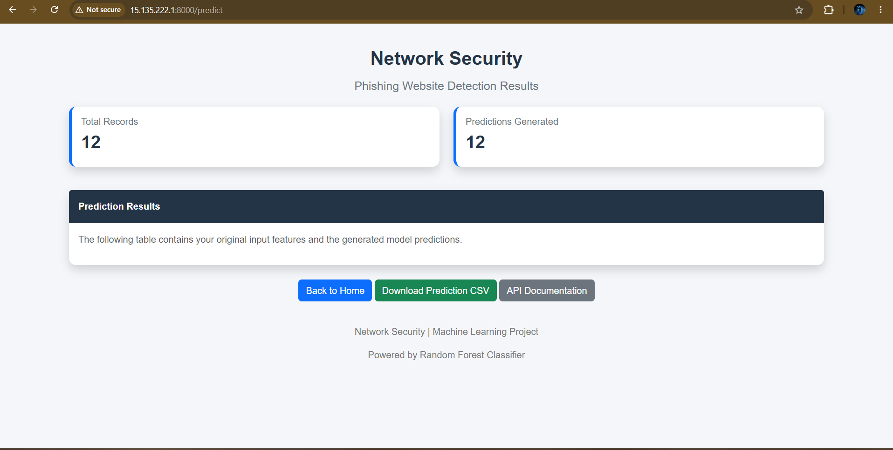
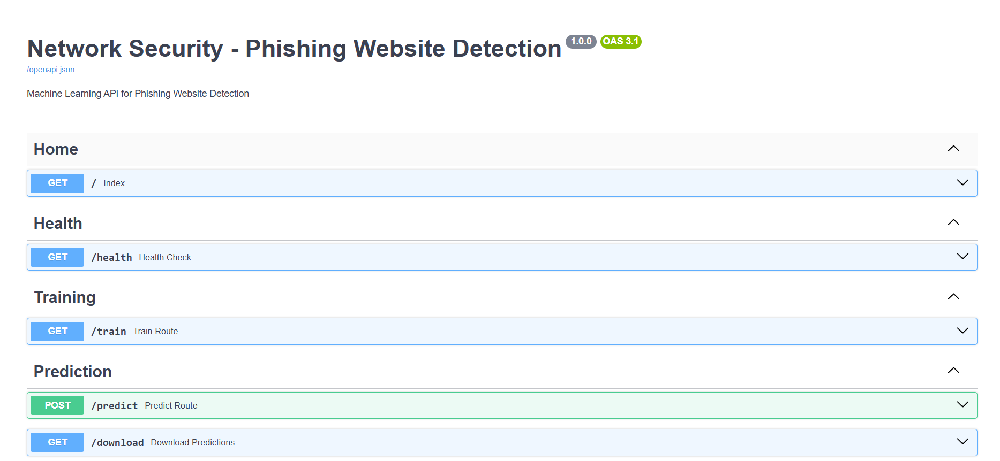

# Network Security – Phishing Website Detection using Machine Learning & AWS CI/CD

An end-to-end machine-learning application that classifies website records as **phishing** or **legitimate**. The project combines a Random Forest model, FastAPI, MongoDB Atlas, Docker, AWS, and GitHub Actions CI/CD.

> **Dataset:** 11,055 records, 30 input features, and 1 target column (`Result`).  
> The 11,055 value is the number of records (rows), not the number of features.

## Application screenshots

### 1. Application home page


### 2. Prediction results page



### 3. FastAPI Swagger documentation



### 4. GitHub Actions CI/CD pipeline


### 5. AWS EC2 deployment


## System architecture


## CI/CD deployment flow


## Project overview

The application accepts website-feature data, preprocesses the input, and passes the 30 features to a trained Random Forest classifier. It then presents the classification result and supports CSV-based batch prediction.

### Key features

- Binary classification: phishing vs. legitimate
- Random Forest machine-learning model
- FastAPI web application and API documentation
- CSV upload and batch prediction workflow
- MongoDB Atlas integration (if enabled in the application configuration)
- Docker containerization
- AWS EC2 hosting and Amazon ECR image registry
- GitHub Actions deployment automation

## Dataset

| Attribute | Value |
|---|---:|
| Total records | 11,055 |
| Input features | 30 |
| Target columns | 1 |
| Total columns | 31 |
| Target column | `Result` |
| Problem type | Binary classification |
| Algorithm | Random Forest Classifier |

The target-label interpretation (which numeric value represents phishing or legitimate) should match the label mapping used in the training code. Verify that mapping before describing numeric labels in a report.

## Technology stack

| Area | Technology |
|---|---|
| Language | Python |
| Data processing | Pandas, NumPy |
| Machine learning | Scikit-learn |
| Classifier | Random Forest |
| API / backend | FastAPI, Uvicorn |
| Database | MongoDB Atlas |
| Containerization | Docker |
| Cloud hosting | AWS EC2 |
| Container registry | Amazon ECR |
| CI/CD | GitHub Actions |
| Version control | Git, GitHub |

## Application endpoints

The following are the routes shown in the project's API documentation. Confirm the method and behavior in the current application code if you change the API.

| Endpoint | Method | Purpose |
|---|---|---|
| `/` | GET | Home / index |
| `/health` | GET | Health check |
| `/docs` | GET | Swagger API documentation |
| `/train` | GET | Training route |
| `/predict` | POST | Prediction route |
| `/download` | GET | Download predictions |

## Run locally

### 1. Clone the repository

```bash
git clone https://github.com/Ravinuthala-Venkata-Siva-Prasad/Network-Security-Phishing-Website-Detection-using-Machine-Learning-AWS-CI-CD.git
cd Network-Security-Phishing-Website-Detection-using-Machine-Learning-AWS-CI-CD
```

### 2. Create and activate a virtual environment

Windows:

```bash
python -m venv venv
venv\Scripts\activate
```

Linux / macOS:

```bash
python3 -m venv venv
source venv/bin/activate
```

### 3. Install dependencies

```bash
pip install -r requirements.txt
```

### 4. Configure environment variables

Create a local `.env` file only if your application requires these settings:

```env
MONGO_DB_URL=your_mongodb_connection_string
ENABLE_DAGSHUB_TRACKING=false
```

Use your own connection string. **Never commit `.env`, database passwords, API tokens, or cloud credentials to GitHub.** Ensure `.env` is included in `.gitignore` and `.dockerignore`.

### 5. Start the application

```bash
python app.py
```

Open:

- Home page: `http://127.0.0.1:8000/`
- Swagger docs: `http://127.0.0.1:8000/docs`
- Health check: `http://127.0.0.1:8000/health`

## Run with Docker

Build the image:

```bash
docker build -t network-security .
```

Run the container (if your app uses a local `.env` file):

```bash
docker run -d \
  --name network-security-container \
  -p 8000:8000 \
  --env-file .env \
  network-security
```

Check the container:

```bash
docker ps
docker logs network-security-container
```

## AWS deployment and CI/CD

The deployment design shown in the project uses GitHub Actions, a self-hosted runner, Docker, Amazon ECR, and AWS EC2. The successful workflow run and EC2 instance are shown in the screenshots above.

For a public production deployment, use HTTPS, a domain name, restricted security-group rules, least-privilege IAM permissions, and managed secrets. Do not expose database credentials in workflow files or logs.

## Repository structure

The structure below is illustrative. Keep the paths aligned with the files that actually exist in your repository.

```text
Network-Security/
├── app.py
├── requirements.txt
├── Dockerfile
├── .dockerignore
├── .gitignore
├── README.md
├── final_model/
│   └── model.pkl
├── prediction_output/
├── templates/
│   ├── index.html
│   └── table.html
├── src/
│   ├── components/
│   ├── pipeline/
│   ├── constant/
│   └── utils/
├── .github/
│   └── workflows/
│       └── deploy.yml
└── docs/
    └── images/
        ├── home-page.png
        ├── prediction-results.png
        ├── swagger-api.png
        ├── github-actions-deployment.png
        ├── aws-ec2-deployment.png
        ├── system-architecture.png
        └── cicd-deployment.png
```

## Future improvements

- Add model evaluation results and a confusion matrix to the documentation.
- Compare Random Forest with additional classification algorithms.
- Add model and prediction monitoring.
- Add authentication and request validation.
- Configure HTTPS and a custom domain.
- Integrate current threat-intelligence sources for URL-level analysis.

## Author

**Ravinuthala Venkata Siva Prasad**

- GitHub: [Network Security – Phishing Website Detection](https://github.com/Ravinuthala-Venkata-Siva-Prasad/Network-Security-Phishing-Website-Detection-using-Machine-Learning-AWS-CI-CD)
- LinkedIn: [LinkedIn profile](https://www.linkedin.com/in/ravinuthula-venkata-siva-prasad/)

## Disclaimer

This project is intended for educational and research purposes. Predictions are model outputs and should not be treated as a guarantee that a website is safe or malicious.
