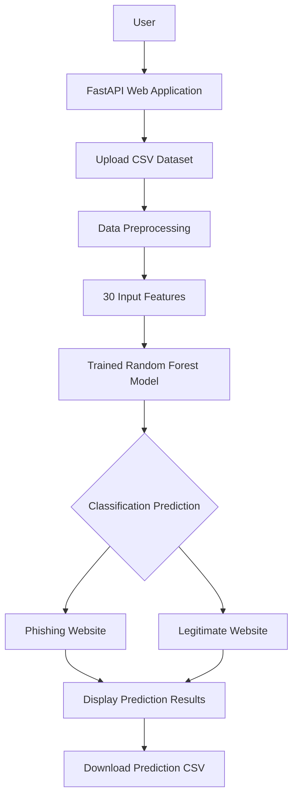
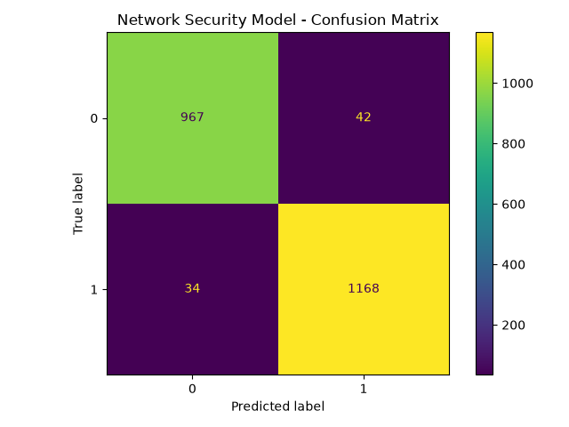
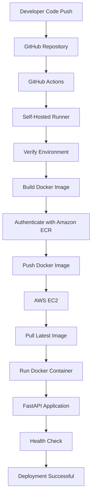

# 🛡️ Network Security – Phishing Website Detection using Machine Learning & AWS CI/CD

An end-to-end Machine Learning and deployment project that detects phishing websites using a **Random Forest Classifier**. The application integrates FastAPI, MongoDB Atlas, Docker, AWS EC2, Amazon ECR, and GitHub Actions to automate the deployment of a Machine Learning application.

<p align="center">
  
</p>

<p align="center">
  <b>Machine Learning | FastAPI | Docker | AWS | GitHub Actions CI/CD</b>
</p>

---

## 📌 Table of Contents

- [Project Overview](#-project-overview)
- [Key Features](#-key-features)
- [Dataset Information](#-dataset-information)
- [Technology Stack](#-technology-stack)
- [System Architecture](#-system-architecture)
- [Machine Learning Workflow](#-machine-learning-workflow)
- [Model Evaluation](#-model-evaluation)
- [Confusion Matrix](#-confusion-matrix)
- [Application Screenshots](#-application-screenshots)
- [API Endpoints](#-api-endpoints)
- [Evidence and Validation](#-evidence-and-validation)
- [CI/CD Pipeline](#-cicd-pipeline)
- [AWS Deployment](#-aws-deployment)
- [Local Installation](#-local-installation)
- [Docker Deployment](#-docker-deployment)
- [Project Structure](#-project-structure)
- [Challenges and Solutions](#-challenges-and-solutions)
- [Future Improvements](#-future-improvements)
- [Learning Outcomes](#-learning-outcomes)
- [Author](#-author)

---

## 📖 Project Overview

Phishing is a cybersecurity threat in which attackers create fraudulent websites that imitate legitimate websites to steal sensitive information, including login credentials, personal information, and financial details.

This project uses Machine Learning to analyze website-related attributes and classify websites into two categories:

- **Phishing:** A website classified as potentially malicious.
- **Legitimate:** A website classified as legitimate by the trained model.

A Random Forest classification model is trained using website feature data and integrated into a FastAPI web application.

Users can upload CSV files containing website features and receive predictions through the web interface.

The application is containerized using Docker and deployed on AWS EC2. GitHub Actions automates the Docker build and deployment workflow.

### Project Highlights

- End-to-end Machine Learning pipeline.
- 11,055 dataset records and 30 input features.
- Random Forest binary classification.
- FastAPI web application.
- CSV-based batch prediction.
- MongoDB Atlas integration.
- Docker containerization.
- AWS EC2 and Amazon ECR deployment.
- GitHub Actions automated CI/CD.

---

## 🚀 Key Features

- Phishing website detection using Machine Learning.
- Random Forest classification algorithm.
- Automated data ingestion and preprocessing.
- Model training and evaluation.
- FastAPI-based web application.
- CSV upload and batch predictions.
- Prediction results displayed through a web interface.
- Prediction output available for download.
- MongoDB Atlas integration.
- Docker image creation and container management.
- AWS cloud deployment.
- Amazon ECR image storage.
- GitHub Actions CI/CD automation.
- Application health-check endpoint.
- Interactive Swagger API documentation.

---

## 📊 Dataset Information

The Machine Learning model was trained using a phishing website dataset.

| Dataset Attribute | Value |
|---|---:|
| Total Records | 11,055 |
| Training Records | 8,844 |
| Testing Records | 2,211 |
| Input Features | 30 |
| Target Variables | 1 |
| Total Columns | 31 |
| Target Column | `Result` |
| Problem Type | Binary Classification |
| ML Algorithm | Random Forest Classifier |

### Dataset Explanation

- **11,055 records:** Total number of website samples.
- **30 input features:** Website attributes used by the model.
- **1 target variable:** Classification label.
- **31 total columns:** 30 input features plus one target column.

The dataset was divided into training and testing subsets using an 80:20 split.

The model uses 30 input features to predict whether a website is phishing or legitimate.

---

## 🛠️ Technology Stack

| Category | Technologies |
|---|---|
| Programming Language | Python |
| Machine Learning | Scikit-learn |
| Classification Algorithm | Random Forest |
| Data Processing | Pandas, NumPy |
| Backend Framework | FastAPI |
| Database | MongoDB Atlas |
| Model Serialization | Pickle |
| API Server | Uvicorn |
| Containerization | Docker |
| Cloud Platform | Amazon Web Services |
| Container Registry | Amazon ECR |
| Cloud Hosting | Amazon EC2 |
| CI/CD | GitHub Actions |
| Version Control | Git, GitHub |

---

## 🏗️ System Architecture

The following architecture illustrates the overall application workflow.



---

## 🧠 Machine Learning Workflow

The project follows an end-to-end Machine Learning pipeline.

1. Dataset collection.
2. Data ingestion.
3. Data validation.
4. Data transformation.
5. Feature preparation.
6. Random Forest model training.
7. Model evaluation.
8. Model serialization.
9. Model loading.
10. Website classification and prediction.

### Algorithm: Random Forest Classifier

Random Forest is an ensemble learning algorithm that combines multiple decision trees to perform classification.

The model analyzes 30 input features and generates a binary classification prediction.

### Why Random Forest?

- Combines predictions from multiple decision trees.
- Supports binary classification problems.
- Can capture nonlinear relationships.
- Provides feature-importance information.
- Works well with structured tabular data.

---

## 📈 Model Evaluation

The Random Forest classifier was evaluated on a separate test dataset containing **2,211 records**.

### Evaluation Metrics

| Metric | Score |
|---|---:|
| Accuracy | **96.56%** |
| Weighted Precision | **96.56%** |
| Weighted Recall | **96.56%** |
| Weighted F1-Score | **96.56%** |
| ROC-AUC | **99.41%** |

### Classification Report

| Class | Precision | Recall | F1-Score | Support |
|---|---:|---:|---:|---:|
| 0 | 96.60% | 95.84% | 96.22% | 1,009 |
| 1 | 96.53% | 97.17% | 96.85% | 1,202 |
| Macro Average | 96.57% | 96.50% | 96.53% | 2,211 |
| Weighted Average | 96.56% | 96.56% | 96.56% | 2,211 |

### Evaluation Summary

- Test dataset: 2,211 records.
- Correct predictions: 2,135.
- Incorrect predictions: 76.
- Accuracy: 96.56%.
- ROC-AUC: 99.41%.

The model demonstrates strong classification performance on the held-out test dataset.

---

## 🎯 Confusion Matrix

The following visualization represents the actual and predicted classifications of the Random Forest model on the test dataset.

<p align="center">
  
</p>

### Confusion Matrix Values

| Actual / Predicted | Class 0 | Class 1 |
|---|---:|---:|
| Class 0 | 967 | 42 |
| Class 1 | 34 | 1,168 |

### Interpretation

- 967 Class 0 records were correctly classified as Class 0.
- 42 Class 0 records were incorrectly classified as Class 1.
- 34 Class 1 records were incorrectly classified as Class 0.
- 1,168 Class 1 records were correctly classified as Class 1.

**Total test records:** 2,211

> Class 0 and Class 1 follow the original target-label encoding used during model training. Their phishing/legitimate interpretation depends on the original label mapping.

### Download Evaluation Report

The complete model evaluation results are also available in JSON format.

📄 [View Model Evaluation Report](reports/evaluation_report.json)

The JSON report contains:

- Accuracy
- Precision
- Recall
- F1-Score
- ROC-AUC
- Classification report
- Confusion matrix

---

## 🖥️ Application Screenshots

### 1. Application Home Page

The home page allows users to upload a CSV dataset containing the required website features.


### 2. Prediction Results

The application processes uploaded website records and generates classification predictions.


### 3. FastAPI Swagger Documentation

Swagger UI provides interactive API documentation for testing application endpoints.


### 4. GitHub Actions CI/CD Pipeline

GitHub Actions automates the Docker build and application deployment process.


### 5. AWS EC2 Deployment

The application is hosted on an AWS EC2 instance using Docker.


---

## 🔌 API Endpoints

The FastAPI application provides the following endpoints.

| Endpoint | Method | Description |
|---|---|---|
| `/` | GET | Application home page |
| `/health` | GET | Application health check |
| `/docs` | GET | Swagger API documentation |
| `/train` | GET | Training route |
| `/predict` | POST | Upload CSV and generate predictions |
| `/download` | GET | Download prediction results |

### Health Check

The health endpoint checks whether the FastAPI application is running.

**Request:**

```http
GET /health
```

**Successful Response:**

```json
{
    "status": "success",
    "application": "Network Security",
    "message": "API is running successfully"
}
```

### Swagger Documentation

FastAPI provides interactive API documentation.

```text
http://127.0.0.1:8000/docs
```

---

## 🔍 Evidence and Validation

This section demonstrates the implementation and validation of the application.

### 1. Dataset Validation

| Metric | Result |
|---|---:|
| Total Dataset Records | 11,055 |
| Training Records | 8,844 |
| Testing Records | 2,211 |
| Input Features | 30 |
| Target Variables | 1 |

### 2. Prediction Validation

The application was tested using a CSV file containing 12 website records.

| Prediction Result | Records |
|---|---:|
| Legitimate | 9 |
| Phishing | 3 |
| Total Predictions | 12 |

The application generated predictions for all 12 records.

### 3. API Validation

The FastAPI health-check endpoint returned a successful HTTP response.

```text
Endpoint: /health

HTTP Status: 200 OK

Application Status: Success
```

### 4. CI/CD Validation

The configured GitHub Actions workflow completed successfully.

The deployment process included:

- Repository checkout.
- Environment verification.
- Docker image build.
- Amazon ECR authentication.
- Docker image push.
- EC2 container deployment.
- Application health check.

### 5. Cloud Deployment Validation

The application was deployed using AWS EC2 and Docker.

---

## 🔄 CI/CD Pipeline

GitHub Actions automates the application deployment process.

### Deployment Workflow

1. Developer pushes code to GitHub.
2. GitHub Actions triggers the deployment workflow.
3. The self-hosted runner checks out the repository.
4. Python dependencies and project files are verified.
5. Docker image is built.
6. Docker image is pushed to Amazon ECR.
7. EC2 pulls the latest Docker image.
8. The existing application container is replaced.
9. The new Docker container starts.
10. Application health check verifies deployment availability.

### CI/CD Architecture



---

## ☁️ AWS Deployment

The application is deployed using the following AWS services.

| AWS Service | Purpose |
|---|---|
| Amazon EC2 | Hosting the application |
| Amazon ECR | Storing Docker images |
| IAM Role | AWS permissions and access |
| Security Groups | Managing network access |

### Deployment Process

1. Configure an EC2 instance.
2. Install Docker and AWS CLI.
3. Configure the required IAM role and ECR permissions.
4. Create an Amazon ECR repository.
5. Configure the GitHub Actions self-hosted runner.
6. Configure the deployment workflow.
7. Build and push the Docker image to ECR.
8. Pull the image from ECR on EC2.
9. Run the Docker container.
10. Verify the application using the health endpoint.

---

## 💻 Local Installation

Follow these steps to run the project locally.

### 1. Clone the Repository

```bash
git clone https://github.com/Ravinuthala-Venkata-Siva-Prasad/Network-Security-Phishing-Website-Detection-using-Machine-Learning-AWS-CI-CD.git
```

### 2. Navigate to the Project Directory

```bash
cd Network-Security-Phishing-Website-Detection-using-Machine-Learning-AWS-CI-CD
```

### 3. Create a Virtual Environment

```bash
python -m venv venv
```

### 4. Activate the Virtual Environment

**Windows:**

```bash
venv\Scripts\activate
```

**Linux:**

```bash
source venv/bin/activate
```

### 5. Install Dependencies

```bash
pip install -r requirements.txt
```

### 6. Configure Environment Variables

Create a `.env` file in the project root directory.

```env
MONGO_DB_URL=your_mongodb_connection_string
ENABLE_DAGSHUB_TRACKING=false
```

Use your own MongoDB connection string.

**Security:** Never upload database passwords, API tokens, AWS credentials, or `.env` files to GitHub.

### 7. Start the Application

```bash
python app.py
```

### 8. Access the Application

**Home Page:**

```text
http://127.0.0.1:8000/
```

**Swagger Documentation:**

```text
http://127.0.0.1:8000/docs
```

**Health Check:**

```text
http://127.0.0.1:8000/health
```

---

## 🐳 Docker Deployment

### 1. Build Docker Image

```bash
docker build -t network-security .
```

### 2. Run Docker Container

```bash
docker run -d \
  --name network-security-container \
  -p 8000:8000 \
  --env-file .env \
  network-security
```

### 3. Check Running Containers

```bash
docker ps
```

### 4. View Container Logs

```bash
docker logs network-security-container
```

---

## 📁 Project Structure

The following is an illustrative project structure. Adjust it to match the actual files in your repository.

```text
Network-Security/
│
├── app.py
├── requirements.txt
├── Dockerfile
├── .dockerignore
├── .gitignore
├── README.md
│
├── final_model/
│   └── model.pkl
│
├── prediction_output/
│
├── reports/
│   └── evaluation_report.json
│
├── templates/
│   ├── index.html
│   └── table.html
│
├── src/
│   ├── components/
│   ├── pipeline/
│   ├── constant/
│   └── utils/
│
├── .github/
│   └── workflows/
│       └── deploy.yml
│
└── docs/
    └── images/
        ├── home-page.png
        ├── prediction-results.png
        ├── swagger-api.png
        ├── github-actions-deployment.png
        ├── aws-ec2-deployment.png
        └── confusion_matrix.png
```

---

## 🧩 Challenges and Solutions

| Challenge | Solution |
|---|---|
| Model deployment | Integrated the trained model into a FastAPI application |
| Dependency management | Used requirements.txt and Docker |
| Application containerization | Created a Docker image |
| Cloud deployment | Deployed the application on AWS EC2 |
| Docker image storage | Used Amazon ECR |
| Deployment automation | Configured GitHub Actions |
| Application verification | Implemented a health-check endpoint |
| Environment configuration | Used environment variables |

---

## 🔮 Future Improvements

- Improve model performance through hyperparameter tuning.
- Compare additional classification algorithms.
- Add model monitoring and logging.
- Implement HTTPS with a custom domain.
- Improve application security and authentication.
- Add real-time website URL analysis.
- Integrate additional threat intelligence sources.
- Add automated model evaluation reports.
- Implement scheduled model retraining.

---

## 🎯 Learning Outcomes

Through this project, I gained practical experience in:

- End-to-end Machine Learning development.
- Data preprocessing and model training.
- Binary classification using Random Forest.
- Model evaluation using classification metrics.
- Building APIs using FastAPI.
- MongoDB Atlas integration.
- Docker image creation and container management.
- AWS EC2 and Amazon ECR deployment.
- GitHub Actions CI/CD automation.
- Deploying and maintaining a Machine Learning application.
- Integrating Machine Learning with cloud infrastructure.

---

## 👨‍💻 Author

**Ravinuthala Venkata Siva Prasad**

M.Tech – Computer Science and Engineering (Artificial Intelligence)

**GitHub:**  
[Network Security – Phishing Website Detection](https://github.com/Ravinuthala-Venkata-Siva-Prasad/Network-Security-Phishing-Website-Detection-using-Machine-Learning-AWS-CI-CD)

**LinkedIn:**  
[LinkedIn Profile](https://www.linkedin.com/in/ravinuthala-venkata-siva-prasad/)

---

## 📜 Disclaimer

This project is intended for educational and research purposes.

Machine Learning predictions are not a guarantee that a website is safe or malicious. Suspicious websites should be verified using additional security tools.
