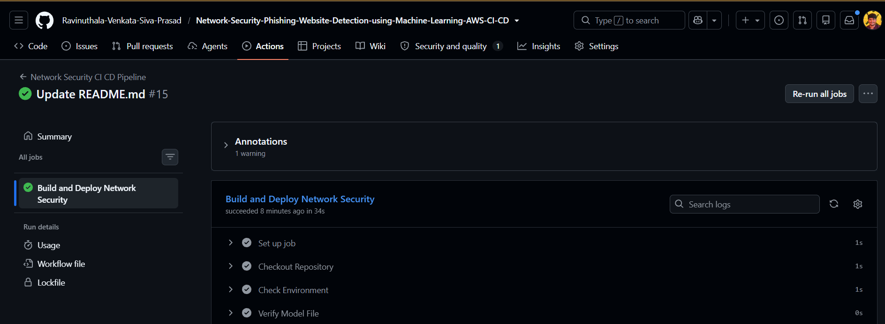
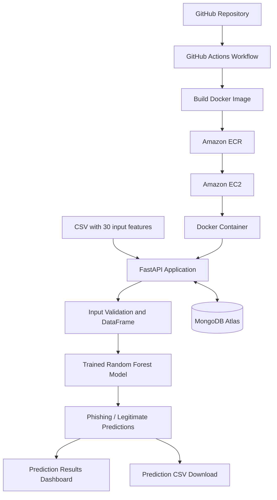
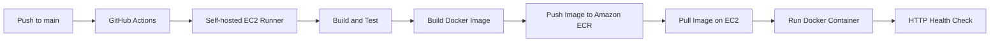

<div align="center">

# 🛡️ Network Security — Phishing Website Detection

### An end-to-end Machine Learning application with FastAPI, MongoDB Atlas, Docker, AWS, and GitHub Actions CI/CD

[](https://www.python.org/)
[](https://fastapi.tiangolo.com/)
[](https://www.docker.com/)
[](https://aws.amazon.com/)
[](https://github.com/features/actions)
[](https://www.mongodb.com/atlas)

</div>

---

## 📌 Project Overview

**Network Security** is a machine-learning-based phishing website detection project. It uses a trained **Random Forest classifier** to classify website records from a CSV file as **Phishing** or **Legitimate**, based on 30 input features.

The model is served through a **FastAPI** web application. Users can upload a CSV file, generate predictions, view the prediction summary, and download the prediction output.

The project also includes a machine-learning pipeline and an automated deployment workflow using **Docker, Amazon ECR, Amazon EC2, and GitHub Actions**. MongoDB Atlas is used for database connectivity, while MLflow and DagsHub are included in the project dependencies for experiment tracking.

> **Important:** This application classifies feature records supplied in a CSV. It does not establish that a website is safe, and a prediction should not be treated as a security guarantee.

## ✨ Key Features

- **Phishing classification:** Random Forest model predicts phishing or legitimate classes.
- **CSV upload:** Submit a CSV containing the model's expected 30 input features.
- **Batch prediction:** Generate predictions for multiple records in one request.
- **Results dashboard:** View the number of uploaded records and generated predictions.
- **CSV export:** Download the generated prediction output.
- **FastAPI endpoints:** Application, health, training, prediction, and download routes.
- **MongoDB Atlas integration:** Connect the application to MongoDB Atlas.
- **ML pipeline:** Project source includes data ingestion, validation, transformation, and model-training components.
- **Docker containerization:** Package the application and its dependencies into a Docker image.
- **AWS deployment:** Store the image in Amazon ECR and run the container on Amazon EC2.
- **GitHub Actions CI/CD:** Automate build and deployment when the workflow is triggered.

## 🖥️ Application Screenshots

Create `docs/images/` and add screenshots with these exact filenames to display them here.

### Home page


### Prediction results


### API documentation


### GitHub Actions deployment


### AWS deployment


## 🏗️ System Architecture



### CI/CD deployment flow



## 🧰 Technology Stack

| Category | Technologies |
|---|---|
| Programming language | Python 3.10 |
| Machine learning | Scikit-learn, Random Forest |
| Data processing | Pandas, NumPy |
| API | FastAPI, Uvicorn |
| Front end | HTML templates rendered with Jinja2 |
| Database | MongoDB Atlas, PyMongo |
| Experiment tracking dependencies | MLflow, DagsHub |
| Containerization | Docker |
| Cloud | AWS EC2, Amazon ECR |
| CI/CD | GitHub Actions, self-hosted runner |
| Configuration | python-dotenv |
| TLS certificates | Certifi |

## 🔍 How It Works

1. Prepare a CSV file containing the **30 features expected by the trained model**.
2. Upload the CSV through the web application.
3. FastAPI reads the file into a Pandas DataFrame.
4. The application loads the trained model from `final_model/model.pkl`.
5. The model generates a prediction for each row.
6. The application adds prediction fields to the output.
7. The results page displays the prediction summary.
8. Download the generated CSV for further analysis.

The prediction output includes:

- `predicted_column` — numerical model output.
- `prediction_result` — human-readable prediction label.

The current application mapping is **0 = Phishing** and **1 = Legitimate**. Verify this mapping against the label transformation used during model training before relying on the result.

## 🔌 API Endpoints

| Method | Endpoint | Purpose |
|---|---|---|
| `GET` | `/` | Displays the application home page |
| `GET` | `/health` | Returns application health status |
| `GET` | `/train` | Invokes the model training pipeline |
| `POST` | `/predict` | Accepts a CSV upload and generates predictions |
| `GET` | `/download` | Downloads the generated prediction CSV |

Swagger UI:

```text
http://<HOST>:8000/docs
```

Health check:

```text
http://<HOST>:8000/health
```

Example successful health response:

```json
{
  "status": "success",
  "application": "Network Security",
  "message": "API is running successfully"
}
```

## 📁 Repository Structure

```text
Network-Security/
├── .github/workflows/       # GitHub Actions CI/CD workflow
├── data/                    # Project data
├── data_schema/             # Data schema definitions
├── prediction_output/       # Generated prediction output
├── src/
│   ├── components/          # ML pipeline components
│   ├── configuration/       # Configuration modules
│   ├── constant/            # Project constants
│   ├── data_access/         # Data access utilities
│   ├── entity/              # Configuration and artifact entities
│   ├── exception/           # Custom exceptions
│   ├── logging/             # Logging configuration
│   ├── pipeline/            # Training pipeline
│   └── utils/               # Utility functions
├── templates/               # HTML templates
├── tests/                   # Tests
├── valid_data/              # Validated data
├── app.py                   # FastAPI application
├── main.py                  # Pipeline entry point
├── push_data.py             # Data upload utility
├── Dockerfile               # Docker image definition
├── requirements.txt         # Python dependencies
├── setup.py                 # Package configuration
└── README.md
```

## ⚙️ Local Setup

### 1. Clone the repository

```bash
git clone https://github.com/Ravinuthala-Venkata-Siva-Prasad/Network-Security.git
cd Network-Security
```

### 2. Create and activate a virtual environment

Windows:

```powershell
python -m venv .venv
.venv\Scripts\activate
```

Linux / macOS:

```bash
python3 -m venv .venv
source .venv/bin/activate
```

### 3. Install dependencies

```bash
python -m pip install --upgrade pip
pip install -r requirements.txt
```

### 4. Configure environment variables

Create a local `.env` file:

```env
MONGO_DB_URL=mongodb+srv://<username>:<password>@<cluster>.mongodb.net/<database>
ENABLE_DAGSHUB_TRACKING=false
```

Replace placeholders with your own MongoDB Atlas configuration. Do not commit `.env`, database credentials, cloud keys, or tokens to GitHub.

### 5. Run the application

```bash
python app.py
```

Open `http://127.0.0.1:8000/` and visit `http://127.0.0.1:8000/docs` for Swagger UI.

> The application expects the trained model at `final_model/model.pkl`. Ensure the model artifact is available before running predictions.

## 🐳 Docker

Build the image:

```bash
docker build -t networksecurity:latest .
```

Run the container:

```bash
docker run -d --name network-security-container -p 8000:8000 --env-file .env networksecurity:latest
```

View logs and status:

```bash
docker logs --tail 100 network-security-container
docker ps
```

## ☁️ AWS Deployment and CI/CD

The project has been deployed using:

- **GitHub Actions:** Runs the automated deployment workflow.
- **Self-hosted runner:** Executes the workflow on the EC2 host.
- **Docker:** Builds and runs the application container.
- **Amazon ECR:** Stores the Docker image.
- **Amazon EC2:** Hosts the running application.
- **MongoDB Atlas:** Provides the database service.

Deployment sequence:

1. Push a change to the configured GitHub branch or manually trigger the workflow.
2. GitHub Actions checks out the repository and runs the configured checks.
3. The workflow builds the Docker image.
4. The image is pushed to Amazon ECR.
5. EC2 pulls the image from ECR.
6. The application container is started or replaced.
7. The workflow calls `/health` to verify the application.

Keep credentials in the EC2 environment file or an appropriate secrets manager. Never store secrets in the repository or workflow source. Restrict inbound access through security groups. For production, use HTTPS through a domain and reverse proxy or load balancer rather than exposing the application port directly.

## 🧪 Testing

Run tests:

```bash
pytest -q
```

Check the API:

```bash
curl -i http://127.0.0.1:8000/health
```

For prediction testing, upload a representative CSV containing the expected 30 features through `/predict`. Compare predictions with ground-truth labels when evaluating model performance.

## 📊 Model Evaluation

Evaluate the classifier on a held-out dataset using:

- Accuracy
- Precision
- Recall
- F1-score
- Confusion matrix
- ROC-AUC (when prediction scores are available)

Do not report an accuracy value unless it has been measured on a documented test set. A successful health check confirms that the service is running; it does not measure model accuracy.

## 🔐 Security Notes and Limitations

- Treat model predictions as decision support, not a guarantee that a website is safe or malicious.
- False positives and false negatives are possible.
- Keep MongoDB URIs, AWS credentials, DagsHub tokens, and other secrets out of source control.
- Use HTTPS for public-facing deployments.
- Restrict SSH and application access through security group rules.
- Validate uploaded CSV files, including required columns, data types, and file size.
- Retrain and re-evaluate the model when the data distribution changes.

## 🚀 Future Improvements

- Add automated model evaluation reports to CI/CD.
- Add prediction history and monitoring.
- Add model versioning and deployment rollback.
- Configure HTTPS with a custom domain.
- Improve upload validation and user-facing error messages.
- Add monitoring for application health and prediction performance.

## 👨‍💻 Author

**Ravinuthala Venkata Siva Prasad**

- GitHub: [Ravinuthala-Venkata-Siva-Prasad](https://github.com/Ravinuthala-Venkata-Siva-Prasad)
- Repository: [Network-Security](https://github.com/Ravinuthala-Venkata-Siva-Prasad/Network-Security-Phishing-Website-Detection-using-Machine-Learning-AWS-CI-CD)

## 📄 License

This project is distributed under the MIT License. See [LICENSE](LICENSE) for details.
